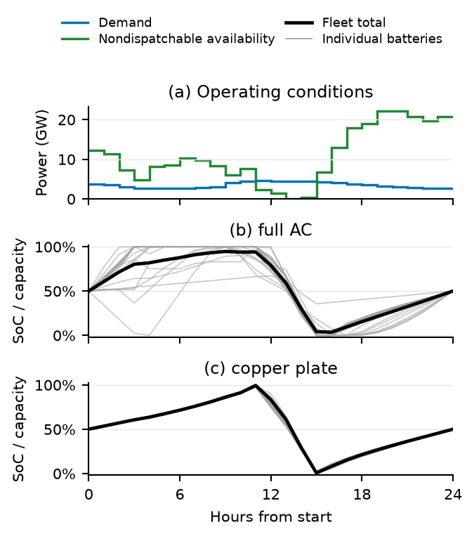

# cvxopf

[](https://github.com/cvxgrp/cvxopf/actions/workflows/ci.yml)
[](https://codecov.io/gh/cvxgrp/cvxopf)

Compositional intertemporal optimal power flow in Python, built on CVXPY.
Model devices once, select network physics from copper plate to full AC,
and coordinate storage across time.

[Installation](#installation) · [Quick start](#quick-start) ·
[Modeling guide](docs/modeling.md) · [Examples](examples/README.md) ·
[Paper and results](#matched-network-fidelity-study)

## Why CVXOPF?

Storage scheduling depends on when energy is needed and where it can be
delivered. Network-model choice can change not just individual operating
setpoints, but operating cost, load service and whether a battery schedule is
physically realizable. CVXOPF provides a common modeling framework for studying those
differences while holding device definitions, time series and initial/final
battery energies fixed.

CVXPY's [disciplined convex programming (DCP)](https://www.cvxpy.org/tutorial/dcp/)
and [disciplined nonlinear programming (DNLP)](https://www.cvxpy.org/tutorial/dnlp/index.html)
frameworks check mathematical composition rules and derive solver
representations. CVXOPF keeps device dynamics, operating limits and costs
convex; nonconvexity is confined to full AC network physics. Shared device
models can therefore be composed with different network formulations without
hand-deriving a separate solver model for each combination.

Multistep optimization jointly schedules generation, renewable curtailment,
load service and battery energy over a planning horizon. Battery-energy
targets from a longer plan, called **energy signposts**, let short AC
optimizations adjust dispatch without fixing the approximate model's battery
power schedule. Repeating these short optimizations while applying only the
first interval's decisions is an **AC rollout**. See the
[architecture guide](PROJECT_FLOWCHART.md) for how device models connect to
network models.

## Models and capabilities

| Formulation key | Network model | Convex | Default solver |
| --- | --- | --- | --- |
| `"singlenode_dc"` | Copper plate: aggregate balance, no network limits or losses | Yes | CLARABEL |
| `"lossy_dc"` | Network-flow approximation with a quadratic penalty representing line losses | Yes | CLARABEL |
| `"socp"` | Second-order cone (SOCP) relaxation of AC physics using sparse voltage products | Yes | CLARABEL |
| `"ac"` | Full nonlinear AC physics, including two-terminal apparent-power limits | No | IPOPT |

**Caveats.** `lossy_dc` is a network-flow approximation, not a phase-angle DC model.
SOCP feasibility does not establish AC realizability; audit and voltage
recovery are explicit, separate operations. Its reported objective is not a
certified lower bound. AC solutions are local numerical solutions, not
certified global optima.

Shared components cover:

- Dispatchable generators with polynomial or piecewise-linear costs.
- Lossless batteries with real/reactive inverter limits, energy dynamics
  across time, cycling cost and optional final-energy constraints or penalties.
- Nondispatchable generation, such as wind and solar, with time-varying
  availability and the option to curtail output.
- Loads that must be served or may be curtailed at a specified cost, with
  time series matched by device ID and reporting of unserved energy.
- High-voltage DC (HVDC) links with fixed-direction proportional losses;
  these links are ignored in the copper-plate model, which has only one bus.

See the [modeling guide](docs/modeling.md) for each formulation's network physics
and device capabilities, along with units, returned quantities and worked
examples.

## Installation

Requires Python 3.11+ and CVXPY 1.9.3+ (installed as a dependency).
Install the IPOPT system library **before** installing the Python package;
`cyipopt` is a package dependency, including for convex-only use.

**Ubuntu / Debian**

```bash
sudo apt-get update
sudo apt-get install -y coinor-libipopt-dev liblapack-dev libblas-dev gfortran
```

The LAPACK/BLAS libraries and Fortran compiler are needed to build/link
IPOPT's solver dependencies on Linux.

**macOS**

```bash
brew install ipopt
```

**Windows** (conda recommended)

```bash
conda install -c conda-forge ipopt
```

Then install CVXOPF from the repository:

```bash
pip install git+https://github.com/cvxgrp/cvxopf.git
```

For source development, clone the repository and use
`uv sync --extra dev --extra notebook`; see [Development](#development).
IPOPT setup details are in the
[upstream installation guide](https://coin-or.github.io/Ipopt/INSTALL.html).

## Quick start

Build an AC problem using a built-in MATPOWER test case:

```python
from cvxopf import build_opf, extract_results
from cvxopf.testcases import case9

build = build_opf(case9(), formulation="ac")
build.solve()
results = extract_results(build)
print("Status:", results["status"])
if results["Pg"] is not None:
    print("Objective:", results["objective"])
    print("Generation (MW):", results["Pg"])
```

Change `formulation` to `"socp"`, `"lossy_dc"` or `"singlenode_dc"` to
use another network model. Use `build.solve()` to select the appropriate
solver and convert the model to solver-ready form, including any configured
numerical preparation (scaling and equivalent reformulations).

Check solver status and physical constraint violations when evaluating results.
The [formulation examples](docs/modeling.md#formulation-examples) explain the
returned quantities and demonstrate SOCP auditing and voltage recovery.

## Multistep storage example

Pass one row per interval and one column per bus for MATPOWER demand.
This three-hour example jointly optimizes battery dispatch and restores the
battery's initial energy at the end of the horizon.

```python
import numpy as np
import pandas as pd

from cvxopf import StorageUnitIdeal, build_opf_multistep, extract_results
from cvxopf.testcases import case9

case = case9()
scales = [0.8, 1.0, 1.2]
df_P = pd.DataFrame(np.outer(scales, case["bus"][:, 2]))
df_Q = pd.DataFrame(np.outer(scales, case["bus"][:, 3]))
battery = StorageUnitIdeal(
    bus=5,
    apparent_power_rating=50.0,  # MVA
    capacity=100.0,              # MWh
    initial_soc=50.0,            # MWh
    terminal_soc=50.0,
    terminal_constraint="equality",
    device_id="battery-5",
)

build = build_opf_multistep(
    case, df_P, df_Q, T=3, formulation="ac",
    storage=[battery], delta=1.0,
)
build.solve()
results = extract_results(build)
print("Status:", results["status"])
if results["soc"] is not None:
    print("Post-step battery energy (MWh):", results["soc"])
```

`delta` is the interval duration in hours. Total cost integrates operating
cost rates over time and adds end-of-horizon costs once. Storage power is
positive for discharge; extracted multistep arrays have time along the first
axis. Device IDs match renewable, load and HVDC time-series columns to the
correct devices. See [final-energy constraints and penalties](docs/modeling.md#battery-storage-example),
[time-series and variable layouts](docs/modeling.md#multi-step-example), and
[objective units](docs/modeling.md#objective-units-and-time-discretization).

## Energy-signpost control

The `solve_hierarchical_opf()` controller plans with `lossy_dc` and solves
short AC planning horizons. It passes battery state-of-charge targets, not
generator or battery-power setpoints. After solver and physical constraint
checks pass, it applies the first interval's decisions, updates battery
energy and replans.

The public controller supports loads that cannot be shed and storage devices
with explicit device IDs, with numerical preparation disabled. The paper uses
a separate experimental rollout implementation that supports economic shedding
and numerical preparation. See the runnable
[hierarchical example](examples/case9_hierarchical_dc_ac.py) and
[controller guide](docs/modeling.md#hierarchical-dc-to-ac-control) for
configuration, acceptance checks and recovery behavior.

## Matched network-fidelity study

The current IEEE Power & Energy Society (PES) paper draft, *Network-Model
Fidelity in Intertemporal Storage Dispatch: A Matched Study with CVXOPF*, compares four network models
on six selected deterministic 24-hour scenarios on one configured 118-bus
network. Shared device models, inputs and initial/final battery energies
isolate network-model effects. The study compares joint optimization over
the full day, AC optimization with battery-power schedules fixed to those
from simpler models, and AC rollouts using three-hour planning horizons
with energy signposts.



*The same inputs and initial/final battery energies yield different joint
storage schedules under full AC and copper-plate physics. Black curves show
fleet energy normalized by fleet capacity; gray curves show individual
battery energy normalized by individual capacity.
[Figure provenance](docs/figures/README.md).*

The study found:

- Low approximate-network planning cost need not mean low AC operating cost.
  Fifteen of eighteen fixed-power transfers passed the AC solution checks.
  For the three deficit-to-surplus schedules, a separate interval-arithmetic
  analysis proved incompatibility with AC constraints; failed solves alone
  did not establish this.
- All 24 energy-signpost rollouts completed, covering 576 implemented hours.
  They reduced cost and curtailment while preserving or improving load
  service relative to every accepted fixed-power transfer, and succeeded
  where those fixed schedules were incompatible.
- After one rollout pass, individual battery-energy trajectories moved closer
  to the joint full AC reference in 15 of 18 comparisons of approximate-model
  plans across scenarios. Six rollouts using energy targets from the joint
  full AC solution matched its cost within 0.02 model cost units.

The [appendix](experiments/pes2027/APPENDIX.md) and
[reproduction guide](experiments/pes2027/README.md) document the complete
models, solution checks and limitations of the source plans, including three
approximate-model results in the severe-shortage ("forced shedding") scenario
used despite failing strict numerical checks. They also provide figure
provenance and reproduction instructions. Reproducing the
figures requires saved study results and the author-supplied Tracy input
data, which are not included in the repository.

A separate [matched numerical-preparation study](experiments/numerical_preparation/MATCHED_COMPARISON_REPORT.md)
found that more solves passed the solution checks and AC solves took less
time. Numerical preparation is available as an opt-in feature; see the
[modeling guide](docs/modeling.md#opt-in-numerical-preparation-and-ac-objective-assembly)
for configuration.

## Documentation and examples

- [Modeling guide](docs/modeling.md): formulations, devices, returned quantities,
  multistep model construction, numerical preparation and controller details.
- [Runnable examples](examples/README.md): generation, storage, renewables,
  load shedding, HVDC and formulation comparisons.
- [Architecture](PROJECT_FLOWCHART.md): how models are assembled and how to
  add devices or formulations.
- [Development and roadmap](docs/development.md): notebooks, repository layout,
  reference test-data generation, implementation history and planned capabilities.
- [Paper appendix](experiments/pes2027/APPENDIX.md): complete matched models,
  solution checks and detailed study results.

For an interactive view, run from the repository root:

```bash
uv run --extra notebook marimo run notebooks/cvxopf_demo.py
```

## Development

After installing IPOPT:

```bash
git clone https://github.com/cvxgrp/cvxopf.git
cd cvxopf
uv sync --extra dev --extra notebook
uv run --extra dev --extra notebook pytest tests/ -v
uv run --extra dev ruff check .
```

The full test suite uses both extras to include figure regressions. Tests
requiring saved study data skip when those inputs are unavailable. See the
[development guide](docs/development.md#development) for test coverage, lint
scope and reference test-data generation.

## Status and direction

CVXOPF implements four network formulations, shared device models,
multistep optimization and energy-signpost DC-to-AC control. Planned extensions
include lossy storage, configurable formulation hierarchies, phase-angle DC
power flow and unit commitment. See the
[roadmap](docs/development.md#roadmap) for development status and implementation
history.

## License and acknowledgment

BSD 2-Clause License. Copyright (c) 2026, Alliance for Sustainable Energy, LLC.
See [LICENSE](LICENSE) for the terms.

This work is supported by the U.S. Department of Energy's Office of Electricity
through a grant from the Grid Controls and Communications Division.
