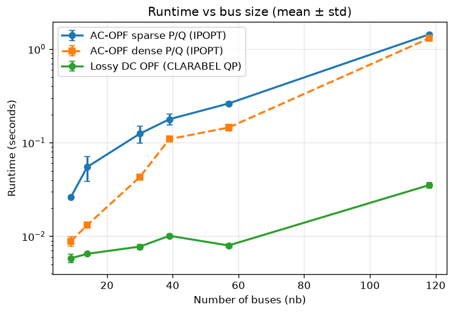

# Development and roadmap

[Back to the README](../README.md) · [Modeling guide](modeling.md)

This guide covers the development environment, tests, source layout and planned
features. Run the commands from the repository root. For installation
prerequisites, including IPOPT, start with the [README](../README.md#installation).

- [Development and tests](#development)
- [Interactive notebooks](#interactive-notebooks)
- [Project structure](#project-structure)
- [Current capabilities and planned work](#roadmap)

## Development

Clone the repository:

```bash
git clone https://github.com/cvxgrp/cvxopf.git
cd cvxopf
```

With [uv](https://docs.astral.sh/uv/), the commands below set up and use the
project's Python environment automatically.

The full test suite needs both the `dev` and `notebook` dependency groups,
because some tests generate figures. The uv test command below includes both.
If you use pip instead, activate your virtual environment and install:

```bash
pip install -e ".[dev,notebook]"
```

The `notebook` group includes marimo, Matplotlib and NetworkX. You need it for
the figure tests even if you do not run a notebook.

To run the test suite:

```bash
# If using uv (recommended)
uv run --extra dev --extra notebook pytest tests/ -v

# If installed directly with pip
pytest tests/ -v
```

Some integration tests use locally stored study data that is not distributed
with the repository. They skip when those files are unavailable. If the files
are present but invalid or incomplete, the tests fail.

Check for common Python errors with Ruff:

```bash
uv run --extra dev ruff check .
```

This checks the package, tests, examples and maintenance scripts.
`experiments/` and `notebooks/` are excluded; check those changes alongside
the relevant study or notebook.

The committed Pypower reference outputs are static test data, not regenerated
during testing. If a case changes or you need to investigate a reference
discrepancy, regenerate them with:

```bash
uv run scripts/generate_pypower_fixtures.py
```

The script runs in a separate environment with
`pypower==5.1.19` and `numpy==2.2.6`. It does not affect the main
package environment.

## Interactive notebooks

To explore dispatch interactively, open the demo:

```bash
uv run --extra notebook marimo run notebooks/cvxopf_demo.py
```

Select a test case (case9 through case118), choose AC-OPF or lossy DC OPF,
and adjust generator limits, branch limits, and load scale interactively.
The AC formulation interprets each positive finite `rateA` as an MVA limit
and enforces it independently at both branch terminals; lossy DC interprets
the selected value as an MW flow limit. Results update automatically after
each solve.

```bash
uv run --extra notebook marimo run notebooks/benchmark_opf.py
```

The benchmark notebook lets you choose the number of repetitions and compare
test cases and OPF configurations. The plot below shows an example run; your
timings will depend on the machine and solver environment.



## Project structure

```
src/cvxopf/           Core package
  problem.py          Public API: build_opf, build_opf_multistep
  ac_problem.py       AC-OPF helpers (DNLP formulation)
  socp_problem.py     Sparse voltage-product SOCP builders
  socp_diagnostics.py SOCP solution checks and voltage recovery
  _admittance_preparation.py  Shared AC/SOCP electrical data preparation
  _numerical_preparation.py   Numerical scaling and coordinate transformations
  dc_problem.py       Lossy DC OPF helpers (convex QP)
  singlenode_dc_problem.py  Single-node DC dispatch helpers (convex QP)
  network.py          Ybus, incidence matrices, reindexing
  cost.py             Generator cost expression builders
  generator.py        DispatchableGenerator component and MATPOWER conversion
  data.py             Input validation and time-series handling
  results.py          Result extraction and comparison utilities
  storage.py          Storage component: data, injections, constraints, cost
  storage_lossy.py    Lossy storage: split powers, efficiencies and self-discharge
  nondispatchable.py  Renewable availability, injections and constraints
  hvdc.py             HVDC component and MATPOWER dcline conversion
  load.py             Fixed and explicitly sheddable load component
  hierarchical.py     DC-to-AC controller and execution records
  testcases/          Built-in MATPOWER test cases (case9 — case118)
tests/                Pytest test suite
tests/fixtures/       Committed Pypower reference outputs (static)
scripts/              Fixture and test case generation scripts
notebooks/            Interactive marimo notebooks
examples/             Runnable example scripts
experiments/          Study scripts, methods and reports
plans/                Feature designs and development history
```

## Roadmap

### Available now

- Four network models: AC, SOCP, lossy DC and single-node dispatch.
- Shared generator, load, renewable, storage and HVDC models.
- Multistep optimization, with time-vectorized assembly by default and an
  optional stepwise layout.
- Storage energy targets and terminal costs, including lossy batteries.
- AC branch-terminal power reporting and apparent-power limits.
- SOCP relaxation checks and voltage recovery.
- A two-layer lossy-DC-to-AC controller that passes battery energy targets
  between planning and operation.
- Opt-in numerical preparation, including separate AC cost coordinates for
  battery charge and discharge.

See the [modeling guide](modeling.md) for each feature's configuration and
limitations. In particular, standalone lossy-storage support does not yet
extend to the public controller.

### Planned extensions

- **Phase-angle DC power flow:** a lossless angle-based model alongside the
  existing network models. See the [design](../plans/milestone-24-phase-angle-dc.md).
- **More flexible control hierarchies:** selectable planning and operating
  models, followed by same-model comparisons and aggregate storage-energy
  targets. See the [hierarchy design](../plans/milestone-21-configurable-hierarchy.md)
  and [proposed extensions](../plans/milestone-25-hierarchy-model-pairs-and-aggregate-signposts.md).
- **Lossy-storage control and polishing:** integrate the battery model into the
  controller, add charge/discharge mode selection and re-solving, and evaluate
  alternative ways to express storage bounds. See the
  [storage follow-ups](../plans/milestone-18-lossy-storage.md#13-deferred-follow-up-backlog).
- **Full HVDC loss and reactive-power models:** allow changing flow direction,
  fixed converter losses and reactive support. See the
  [HVDC design](../plans/milestone-15-full-lossy-hvdc.md).
- **Faster repeated solves:** parameterize more inputs so repeated calls can
  reuse more of the built problem.
- **Optional voltage and reactive-power preferences:** first distinguish
  required support from nonunique dispatch, then assess suitable objective
  terms. See the [design](../plans/milestone-20-ac-voltage-reactive-regularization.md).
- **Interacting load-shedding costs:** represent preferences involving groups
  of loads, with rounding and a final physical solve where needed. See the
  [load-group design](../plans/milestone-22-nonconvex-load-group-penalties.md).
- **Unit commitment:** choose generator on/off schedules in the convex planning
  models, then use the resulting schedule in AC operation. See the
  [commitment design](../plans/milestone-23-unit-commitment.md).

### Implementation history and studies

Detailed development records live in [plans/](../plans/), including the
[shared component architecture](../plans/milestone-16-plus-component-adapters.md),
[input and result handling](../plans/correctness-api-hardening.md),
[controller](../plans/milestone-17-hierarchical-dc-ac.md), and
[lossy-storage preparation tests](../plans/lossy-storage-numerical-preparation.md#7-final-qualification--2026-11-13).

The [time-vectorization record](../plans/milestone-14-time-vectorization.md)
links the correctness and performance comparisons behind the default layout.
Those comparisons include nonuniform timing gains and stepwise AC timeouts.
For the tested cases, solver settings and limitations, see the
[Case118 replay report](../experiments/case118_vectorization_replay/REPORT.md)
and [AC assembly comparison](../experiments/case118_spacetime_pq_replay/FOUR_WAY_STUDY_REPORT.md).
SOCP implementation and study status are documented in its
[development plan](../plans/milestone-11-socp.md).
