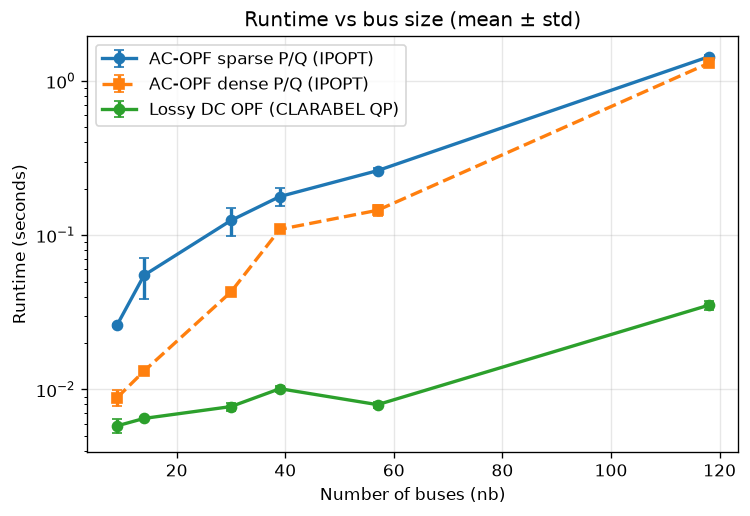

# Development and roadmap

[Back to the README](../README.md) · [Modeling guide](modeling.md)

Commands below are run from the repository root. The roadmap retains the
implementation history and open research plans previously listed in the
README; a completed experiment does not silently close an owner-held gate.

- [Development and tests](#development)
- [Interactive notebooks](#interactive-notebooks)
- [Project structure](#project-structure)
- [Roadmap and implementation history](#roadmap)

## Development

Clone the repository and install in editable mode with development
dependencies:

```bash
git clone https://github.com/cvxgrp/cvxopf.git
cd cvxopf
```

If you have `uv` installed, that's it. Just run things with `uv` from the
project root.

For the complete test suite, include the plotting dependencies as CI does.
With `uv`, select both extras when running tests below. If you manage your own
virtual environment, install them with pip:

```bash
pip install -e ".[dev,notebook]"
```

The `notebook` extra also supplies Marimo; figure regressions require its
Matplotlib and NetworkX dependencies even when no notebook is run.

To run the test suite:

```bash
# If using uv (recommended)
uv run --extra dev --extra notebook pytest tests/ -v

# If installed directly with pip
pytest tests/ -v
```

Owner-data integration tests skip when their declared retained inputs are
absent. Present-but-corrupt inputs and incomplete admitted result bundles
still fail validation; synthetic test fixtures are not study evidence.

Run the project lint policy with:

```bash
uv run --extra dev ruff check .
```

The routine lint gate covers the package, tests, examples, and maintenance
scripts. Exploratory `experiments/` code and interactive `notebooks/` are
excluded; they are reviewed in the context of the study or notebook rather
than held to the library policy.

To regenerate the Pypower reference fixtures (requires `uv`):

```bash
uv run scripts/generate_pypower_fixtures.py
```

Note: the fixture script runs in an isolated environment with pinned
`pypower==5.1.19` and `numpy==2.2.6`. It does not affect the main
package environment.

## Interactive notebooks

We recommend using `uv` (https://docs.astral.sh/uv/) to run the notebooks.
From the project root:

```bash
uv run --extra notebook marimo run notebooks/cvxopf_demo.py
```

Select a test case (case9 through case118), choose AC-OPF or lossy DC OPF,
and adjust generator limits, branch limits, and load scale interactively.
The AC formulation interprets each positive finite `rateA` as an MVA limit
and enforces it independently at both branch terminals; lossy DC interprets
the selected value as an MW flow limit. Results update automatically after
each solve.

```bash
uv run --extra notebook marimo run notebooks/benchmark_opf.py
```

Select number of repetitions and run a timing study across all test cases
and OPF configurations. The results should look something like this:



## Project structure

```
src/cvxopf/           Core package
  problem.py          Public API: build_opf, build_opf_multistep
  ac_problem.py       AC-OPF helpers (DNLP formulation)
  socp_problem.py     Sparse voltage-product SOCP builders
  socp_diagnostics.py Explicit relaxation audits and voltage recovery
  _admittance_preparation.py  Shared AC/SOCP electrical data preparation
  _numerical_preparation.py   Opt-in representation policy and evidence
  dc_problem.py       Lossy DC OPF helpers (convex QP)
  singlenode_dc_problem.py  Single-node DC dispatch helpers (convex QP)
  network.py          Ybus, incidence matrices, reindexing
  cost.py             Generator cost expression builders
  generator.py        DispatchableGenerator component and MATPOWER conversion
  data.py             Input validation and time-series handling
  results.py          Result extraction and comparison utilities
  storage.py          Storage component: data, injections, constraints, cost
  nondispatchable.py  ND component: data, injections, and constraints
  hvdc.py             HVDC component and MATPOWER dcline conversion
  load.py             Fixed and explicitly sheddable load component
  hierarchical.py     Hierarchical DC-to-AC controller and audit records
  testcases/          Built-in MATPOWER test cases (case9 — case118)
tests/                Pytest test suite
tests/fixtures/       Committed Pypower reference outputs (static)
scripts/              Fixture and test case generation scripts
notebooks/            Interactive marimo notebooks
examples/             Runnable example scripts
experiments/          Reviewed scientific studies and retained protocols
plans/                Milestone plans and implementation records
```

## Roadmap

- [ ] Phase-angle DC OPF: add a lossless, angle-constrained network model
  alongside AC, the existing lossy-DC network-flow model, and single-node
  dispatch (planned M24; see [plan](../plans/milestone-24-phase-angle-dc.md)).

- [x] Repository skeleton
- [x] Port and modularize working code
- [x] Pypower fixture generation and validation tests
- [x] Multi-step problem builder
- [x] AC branch-terminal flows and two-terminal apparent-power limits
- [x] Battery/storage model
- [x] Lossy DC OPF and multi-formulation architecture
- [x] HVDC transmission links (lossless + fixed-direction proportional loss, unity power factor)
- [x] Nondispatchable generators
- [x] Sparse P/Q variables for AC-OPF
- [x] Single-node equivalent "copper plate" model
- [ ] SOCP network model — public builder, extraction and explicit audit/recovery
  implemented, with completed reference, matched-comparison and Tracy studies
  linked above; formal milestone closure remains an owner decision.
- [x] Extend battery parameters: terminal equality/shortfall constraints and linear/quadratic terminal costs
- [ ] Extend CVXPY parameterization for faster repeated solves
- [x] M14 agreed implementation, validation and bounded comparison requirements:
  the three formulations in M14's scope are reviewed and owner-accepted. M14a–c are complete and
  merged into `main` with the completed Case118 study. The vectorized lossy-DC
  path's conditioned 24/168/720 prefix ladder and 8,760-hour annual outer are
  accepted. Time-vectorized multistep assembly is now the default; explicit
  stepwise assembly remains available. The historical
  stepwise/CPP profiling
  mismatch and the certificate-backed tight-tolerance disposition are both
  tracked; vectorized/SCIPY with CLARABEL is the authoritative Case118 annual
  realization. A non-promotional default-solver matrix found no accepted
  alternative annual arm. Single-node DC and AC vectorization are implemented,
  with Case9 Tracy comparisons and the existing AC initialization helpers.
  The 168-hour stepwise AC attempts timed out at 180 and 1,800 seconds;
  their unavailable numerical results remain a limitation. The owner accepted
  these bounded outcomes as satisfying the comparison requirement (see
  `plans/milestone-14-time-vectorization.md`).
- [x] Final M14 closure: owner-accepted on 2026-09-20, including the completed
  Case118 replay experiment (126/126 accepted; see
  `experiments/case118_vectorization_replay/REPORT.md`). The stepwise AC timeouts
  and nonuniform replay timing gains remain documented limitations.
- [ ] Full lossy HVDC (sign-switching converter losses via charge/discharge split) and reactive power support
- [x] Unify grid component model patterns (dispatchable generators, storage, nondispatchable → first-class composable components)
- [x] M16+ typed component adapters and shared formulation assembly (see `plans/milestone-16-plus-component-adapters.md`)
- [x] Post-M12/M16 correctness and API hardening: finite temporal inputs, stable unsuccessful-result schemas, and objective time units (see `plans/correctness-api-hardening.md`)
- [x] Hierarchical DC→AC receding-horizon dispatch: long-horizon convex
  planning passes identity-aligned SoC signposts into short AC windows, with
  causal initialization recovery and a complete audit tree (see
  `plans/milestone-17-hierarchical-dc-ac.md`)
- [ ] Configurable and extensible formulation hierarchies: preserve the
  validated M17 `lossy_dc`→`ac` workflow, add typed selectable planning
  formulations, and validate a future three-layer
  `singlenode_dc`→`socp`→`ac` workflow (see
  `plans/milestone-21-configurable-hierarchy.md`)
- [ ] Model-independent hierarchies and aggregate signposts (M25, draft):
  extend M21 with compatible model pairs, same-model shorter-horizon consistency
  checks, and opt-in fleet storage-energy equality through shared cross-device
  coupling assembly. Preserve M17 defaults and individual realized states;
  distinguish objective equivalence from nonunique trajectory identity (see
  [plan](../plans/milestone-25-hierarchy-model-pairs-and-aggregate-signposts.md)).
- [ ] Convex lossy storage with asymmetric efficiency, explicit storage loss, and a relax-round-polish fallback (see `plans/milestone-18-lossy-storage.md`)
- [x] First-class loads and explicit load shedding: identity-aligned
  active/reactive demand, optional single-solve interruption with a sufficiently
  large linear value-of-lost-load cost, and energy-not-served reporting (see
  `plans/milestone-19-load-shedding.md`)
- [ ] AC voltage and reactive-dispatch characterization and optional
  regularization: distinguish required voltage support from unpriced
  nonuniqueness and local-solver selection, then add only scientifically
  justified AC operating preferences (see
  `plans/milestone-20-ac-voltage-reactive-regularization.md`)
- [ ] Nonconvex load-group penalties: model interactions such as mutually
  exclusive customer-group shedding using relaxation, deterministic rounding,
  and fixed-policy polishing (see
  `plans/milestone-22-nonconvex-load-group-penalties.md`)
- [ ] Unit commitment: add opt-in relaxed generator commitment to the convex
  `lossy_dc` and `singlenode_dc` formulations, construct a fixed schedule with
  a deterministic relax–partial-round–resolve–final-round–polish procedure,
  and pass that schedule with polished SoC signposts into an explicitly
  configured AC realization (see
  `plans/milestone-23-unit-commitment.md`)
