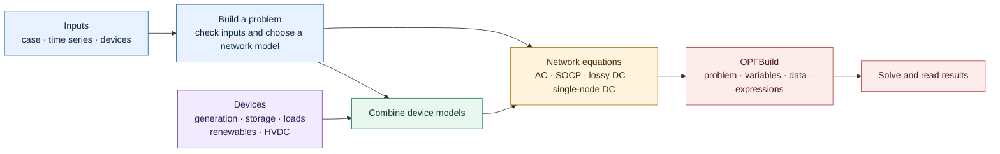
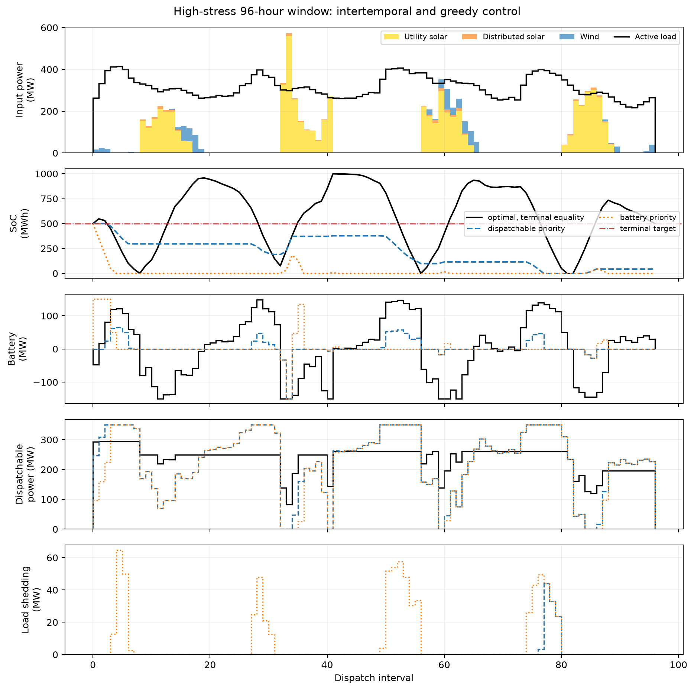

# Modeling guide

[Back to the README](../README.md) · [Examples](../examples/README.md) ·
[Architecture](../PROJECT_FLOWCHART.md)

This guide explains the network models, device inputs, solver options and
returned results. Start with the [installation instructions](../README.md#installation),
then run examples from the repository root. Snippets that use objects such as
`network_case` assume you have supplied those inputs; the linked
[example scripts](../examples/README.md) include complete runnable cases.

- [Modeling approach](#modeling-approach)
- [Formulations and network scope](#formulations)
- [Hierarchical DC-to-AC control](#hierarchical-dc-to-ac-control)
- [Formulation examples and SOCP diagnostics](#formulation-examples)
- [Dispatchable generators](#dispatchable-generators)
- [Multistep assembly and result layouts](#multi-step-example)
- [Objective units](#objective-units-and-time-discretization)
- [Numerical preparation](#opt-in-numerical-preparation-and-ac-objective-assembly)
- [Loads and shedding](#loads-and-load-shedding)
- [Storage and terminal policies](#battery-storage-example)
- [Lossy batteries](#lossy-batteries)
- [Nondispatchable generation](#nondispatchable-generator-example)
- [HVDC links](#hvdc-transmission-link-example)

## Modeling approach

CVXOPF builds optimal power flow problems in CVXPY using
[disciplined convex programming (DCP)](https://www.cvxpy.org/tutorial/dcp/)
and [disciplined nonlinear programming
(DNLP)](https://www.cvxpy.org/tutorial/dnlp/index.html). Network physics and
device models are defined separately: generators, batteries, loads and other
devices use convex constraints and costs, while the nonlinear AC equations
describe power flow through the network.

This lets the same devices work with different network approximations. It
also supports [hierarchical control](#hierarchical-dc-to-ac-control): a
long-horizon convex problem plans battery energy use, and shorter AC solves
choose dispatch that respects the nonlinear network equations.

Renewable generators have both time-varying available power and an inverter
rating. AC and SOCP also model their reactive-power capability. Loads can come
from MATPOWER bus data or explicit `Load` objects, with optional shedding
penalized directly in the objective.

<a id="economic-decisions-from-modeled-primitives"></a>

### How costs shape dispatch

Dispatch depends on the physical system and its costs:

- generator cost curves;
- load and renewable availability;
- network limits and either physical AC losses or a documented DC loss proxy;
- storage dynamics, cycling cost, and terminal policy (with ideal efficiency
  in `StorageUnitIdeal`, or conversion and self-discharge losses in
  `StorageUnitLossy`);
- load-shedding cost; and
- the energy already stored at the start of each interval.

There is no built-in input for a market-price time series. Instead, the model
represents generation costs, available resources, network restrictions and
the cost of unserved load directly. This is useful for outage and recovery
studies, where historical prices may describe a very different physical system.

Tariffs or contracts can be represented through explicitly defined costs or
constraints when they are part of the question being studied.

Voltage and reactive power must satisfy their physical limits, but normally
have no separate cost. A value at a limit can reflect required support,
multiple equally priced solutions, or the nonlinear solver's choice of local
solution. A planned [voltage/reactive-power study](../plans/milestone-20-ac-voltage-reactive-regularization.md)
will examine these effects before adding optional operating preferences.

Choose a network formulation and supply the devices when calling a builder.
The returned `OPFBuild` contains the problem and its variables; use
`build.solve()` to solve it and `extract_results(build)` to read the results.



For the code behind this process, see the
[software architecture guide](../PROJECT_FLOWCHART.md).

## Formulations

| Key | Description | Convex | Solver |
|---|---|---|---|
| `"ac"` | Nonlinear AC-OPF with two-terminal apparent-power branch limits via CVXPY DNLP (requires `cvxpy>=1.9.3`) | No | IPOPT |
| `"socp"` | Sparse voltage-product AC relaxation with shared active/reactive devices and two-terminal branch limits; not automatically AC-realizable | Yes | CLARABEL |
| `"lossy_dc"` | Lossy DC OPF (Boyd et al.) | Yes | CLARABEL |
| `"singlenode_dc"` | Single-node "copper-plate" DC dispatch | Yes | CLARABEL |

AC branch-limit enforcement is enabled by default. `rateA == 0` means no
thermal limit; every positive finite value is enforced at both terminals,
including large values that MATPOWER may treat as unconstrained sentinels.
Set `OPFOptions(enforce_branch_limits=False)` to report terminal flows without
enforcing these limits. A positive `sparsity_tol` requires this option too,
because dropping small admittance entries would otherwise conflict with the
full branch equations used for the limits.

AC supports the following network features:

- Implemented: MATPOWER branch status; fixed tap ratios and phase shifts;
  line charging and bus shunts; voltage-magnitude bounds; nonlinear nodal
  real/reactive balance; generator real/reactive bounds; and two-terminal
  apparent-power limits using `rateA`.
- Not yet implemented: branch angle-difference bounds (`ANGMIN`/`ANGMAX`);
  selection or contingency use of alternate `rateB`/`rateC` ratings; soft
  thermal limits; current-magnitude or active-power-only branch limits;
  time-varying or contingency-dependent ratings; topology switching; and
  controllable transformer tap or phase-shift decisions.

The fixed electrical data in the branch table still enters the AC equations
even when its associated operating control is not implemented. See the
[branch-limit documentation](../plans/milestone-4-branch-limits.md) for details
and planned extensions.

The `"singlenode_dc"` formulation collapses the whole network to a single
bus: no branch flows, no transmission limits, no losses, no reactive power —
just total generation equals total load. It is the classic economic dispatch
problem, useful as a fast baseline and for large-horizon energy planning.

## Hierarchical DC-to-AC control

`solve_hierarchical_opf()` combines a long-horizon `lossy_dc` plan with short
AC operating windows. The plan supplies battery state-of-charge targets
(energy signposts), matched by device ID. It does not prescribe generator,
renewable, HVDC or battery-power setpoints. The controller checks each AC
solution against the physical constraints and chosen terminal-target policy
before executing its first interval, updating the actual battery state and
repeating.

By default, `shifted_with_recovery` uses the previous successful AC prediction
as the next starting guess, then tries a fixed sequence of alternatives if
needed. Choose `flat_only` to start each window from a flat guess instead.
These strategies can help a solve, but cannot guarantee convergence or that
every future target will be feasible.

The returned `HierarchicalResult` includes the plans, solver attempts and
starting points, executed actions, costs and reason for stopping. Only executed
intervals contribute to the realized trajectory and its cost. A solve used
only to find a starting guess is kept in the record, not counted as an action.

```python
result = solve_hierarchical_opf(
    HierarchicalInputs(
        case=case,
        horizon_steps=T,
        delta=1.0,
        generators=generators,
        loads=loads,
        storage=storage,  # every unit has a unique device_id
        df_load_p=df_load_p,
        df_load_q=df_load_q,
        nondispatchable=renewables,
        df_nd=df_renewables,
    ),
    HierarchicalPolicy(
        ac_window_steps=5,
        outer_policy="replan_every_step",
        inner_terminal_policy="hard_equality",
        initialization_policy="shifted_with_recovery",
    ),
)
```

The public controller currently supports ideal batteries and nonsheddable
loads, with numerical preparation disabled. Storage devices need unique IDs.
It uses CLARABEL for planning and IPOPT for AC operation. The controller
requires AC branch limits to remain enabled (`enforce_branch_limits=True`). See
[`examples/case9_hierarchical_dc_ac.py`](../examples/case9_hierarchical_dc_ac.py)
for a runnable example and the
[controller documentation](../plans/milestone-17-hierarchical-dc-ac.md) for
terminal-target options, solution checks, recovery and stopping behavior.

References:

- AC OPF: *Disciplined Nonlinear Programming*,
  [paper](https://stanford.edu/~boyd/papers/dnlp.html) and
  [power-flow example](https://github.com/cvxgrp/dnlp-examples/blob/main/nlp_examples/power_flow.ipynb).
- Lossy DC OPF: *Convex Optimization with Smart Grid Examples*,
  [technical report](https://doi.org/10.2172/3018252).

## Formulation examples

### AC-OPF

```python
from cvxopf.testcases import case9
from cvxopf.problem import build_opf
from cvxopf.results import extract_results

build = build_opf(case9(), formulation="ac")
build.solve()
results = extract_results(build)
print(f"Status: {results['status']}")
if results["Pg"] is not None:
    print(f"Objective: {results['objective']:.2f}")
    print(f"Pg (MW):   {results['Pg']}")
```

Result keys are determined by the built model and remain stable when a solve
does not return solution values. Check `status` first: unavailable array-valued
and derived quantities are `None`, while scalar objective and cost quantities
are `NaN`.

AC results include signed terminal powers `branch_p_from`,
`branch_q_from`, `branch_p_to`, and `branch_q_to`, plus apparent magnitudes
`branch_s_from` and `branch_s_to`, all in original MATPOWER branch-table row
order. The `branch_p_*` fields are MW, `branch_q_*` fields are MVAr, and
`branch_s_*` fields are MVA. Each is shaped `(nl,)` for a single-step result
and `(T, nl)` for a multistep result. Real and reactive powers are positive
when entering a branch from the named terminal; apparent powers are
nonnegative.

### Sparse voltage-product SOCP relaxation

```python
from cvxopf import build_opf, extract_results, audit_socp_relaxation, recover_socp_voltage
from cvxopf.testcases import case9

build = build_opf(case9(), formulation="socp")
build.solve()                       # CLARABEL, not IPOPT
results = extract_results(build)    # lightweight; no recovery or audit
audit = audit_socp_relaxation(build, results)
recovery = recover_socp_voltage(build, results)
print(results["status"], audit["feasible"], recovery["ac_feasible"])
```

SOCP represents voltage with squared magnitudes `w` and sparse complex
products `W_re`, `W_im` (p.u.^2), rather than voltage angles. It includes
transformers, shunts, line charging, branch status and limits at both branch
terminals. Generators, loads, storage and HVDC use the same device models as
AC, including reactive load shedding and storage targets. Multistep problems
are time-vectorized by default; stepwise construction is also available.

`voltage_product_pairs` lists zero-based internal bus pairs `(i,j)`, `i<j`,
oriented as `V[i] * conj(V[j])`. Branch mapping arrays retain MATPOWER row
order. Edge arrays have shape `(npairs,)` or `(T,npairs)`; bus and device arrays
follow the usual single-step/time-first conventions. `Vm_relaxed = sqrt(w)`
is not an AC voltage solution, and no `Va_deg` is reported by extraction.
Both-terminal powers use the same units/signs as AC; `branch_loss_mw` is their
signed real-power sum. Empty edge/branch sets have empty arrays, not fictitious
zero flows. Missing nonempty solution arrays remain `None`.

Use `audit_socp_relaxation()` to check the relaxed network and device
constraints, and `recover_socp_voltage()` to construct and check an AC voltage
candidate. Neither runs another solve or changes the inputs. Recovery keeps
the solved device decisions and checks both tightness of the voltage products
and consistency of angles around network cycles. Recovery is unavailable if
values are missing, nonfinite or too close to zero to determine an edge's phase.

`SOCPAuditTolerances` sets physical and recovery thresholds separately. Reports
include signed and normalized determinant gaps, cone violations and the
locations of the largest errors. Diagnostic arrays are always time-first,
even for one interval. Custom coupling constraints cannot be independently
audited; overall feasibility is then `None` unless a checked constraint already
fails.

`enforce_vset` and `enforce_branch_limits` apply. SOCP requires `sparsity_tol=0`
even without branch limits. AC initialization and P/Q-assembly options have no
effect. No DC loss-cost proxy is added; a nondefault `loss_weight` is rejected.

Solver status, feasibility of the relaxation and feasibility of a recovered AC
solution answer different questions. An SOCP objective is a numerical estimate
of the relaxation optimum, not a certified AC lower bound. To compare it with
AC, match the electrical inputs, devices, costs and terminal policies. See the
[reference and matched AC/SOCP results](../experiments/m11_socp/E1_E2_V2_REPORT.md).
The controller does not automatically accept recovered SOCP solutions.

### Lossy DC OPF

```python
from cvxopf.testcases import case14
from cvxopf.problem import build_opf
from cvxopf.results import extract_results

build = build_opf(case14(), formulation="lossy_dc")
build.solve()
results = extract_results(build)
print(f"Objective:  {results['objective']:.2f}")
print(f"Pg (MW):    {results['Pg']}")
print(f"Flows (MW): {results['p_flows']}")
```

### Single-node DC dispatch

Any MATPOWER case works (the branch table is ignored), or use the
`make_singlenode_case` convenience constructor to build a minimal
economic-dispatch problem without a full network:

```python
from cvxopf.testcases import make_singlenode_case
from cvxopf.problem import build_opf
from cvxopf.generator import DispatchableGenerator
from cvxopf.results import extract_results

case = make_singlenode_case(
    P_load_MW=250.0,
    generators=[
        DispatchableGenerator(
            bus=1, p_max_mw=200.0, cost_coeffs=(0.0, 10.0, 0.05)
        ),
        DispatchableGenerator(
            bus=1, p_max_mw=150.0, cost_coeffs=(0.0, 15.0, 0.08)
        ),
    ],
)

build = build_opf(case, formulation="singlenode_dc")
build.solve()
results = extract_results(build)
print(f"Objective: {results['objective']:.2f}")
print(f"Pg (MW):   {results['Pg']}")
```

The `examples/case14_formulation_comparison.py` script solves the IEEE
14-bus case with AC, lossy DC and copper plate side by side and contrasts their
dispatch and implied losses.

<a id="first-class-dispatchable-generators"></a>

### Dispatchable generators

Pass `DispatchableGenerator` objects to define generator locations, operating
bounds, and costs directly. Polynomial costs use lowest-power-first
coefficients and are limited to degree two; piecewise-linear costs use
explicit `(power_MW, cost)`
breakpoints. All cost expressions are evaluated by the shared implementation
in `cost.py`.

```python
from cvxopf import DispatchableGenerator, build_opf

generators = [
    DispatchableGenerator(
        bus=1,
        p_min_mw=10.0,
        p_max_mw=250.0,
        q_min_mvar=-300.0,
        q_max_mvar=300.0,
        cost_type="piecewise_linear",
        cost_points=((0.0, 0.0), (100.0, 2500.0), (250.0, 7250.0)),
    ),
]

# network_case needs bus, branch, and baseMVA, but may omit gen/gencost.
build = build_opf(network_case, formulation="ac", generators=generators)
```

If you omit `generators=`, the builder reads the MATPOWER `gen` and `gencost`
tables. A supplied generator list replaces those tables, which may then be
absent. Building a problem does not modify the input case dictionary.

## Multi-step example

Time-varying load is passed as a DataFrame — one row per time step, one
column per bus. This is the foundation for resilience studies: feed in
a multi-day solar and load profile and the optimizer plans dispatch
across the full horizon in a single solve.

```python
import numpy as np
import pandas as pd
from cvxopf.testcases import case9
from cvxopf.problem import build_opf_multistep
from cvxopf.results import extract_results

ppc     = case9()
T       = 3
Pd_base = ppc["bus"][:, 2]
Qd_base = ppc["bus"][:, 3]

# Three time steps at 80%, 100%, 120% of base load
scales  = [0.8, 1.0, 1.2]
df_P    = pd.DataFrame(np.outer(scales, Pd_base))
df_Q    = pd.DataFrame(np.outer(scales, Qd_base))

build   = build_opf_multistep(ppc, df_P, df_Q, T=T, formulation="ac")
build.solve()
results = extract_results(build)
print(f"Integrated horizon objective: {results['objective']:.2f}")
print(f"Pg per step (MW):\n{results['Pg']}")
```

### Choosing an assembly layout

By default, CVXOPF combines time steps into array expressions for all four
formulations. This is called time-vectorized assembly. Pass
`temporal_assembly="stepwise"` to build separate expressions and variable lists
for each interval instead. Code that accesses `build.variables` must use the
selected layout; extracted result shapes are unchanged.

For vectorized convex builds, `build.solve()` uses CVXPY's SCIPY backend to
convert the problem to solver form; stepwise convex builds use CPP by default.
CLARABEL is the default solver for both. AC uses DNLP/IPOPT in either layout,
with no CPP/SCIPY backend selection.

The hierarchical controller also uses vectorized DC planning and AC operating
problems by default. Set `outer_temporal_assembly="stepwise"` or
`inner_temporal_assembly="stepwise"` to change either layout. Both layouts
support the same initial guesses, recovery sequence and acceptance checks.
Battery states are matched by device ID and carried forward from executed
actions, including in the shorter windows at the end of the horizon. Each AC
attempt records and verifies the complete IPOPT starting vector.

AC also batches real and reactive flow expressions across bus pairs. During
construction and `build.solve()`, CVXOPF disables CVXPY's automatic choice of
sparse derivative evaluation based on matrix density. The previous threshold
is restored afterward, including on errors. This does not disable sparse
storage of P/Q variables. Pass `automatic_sparse_dispatch=True` to either
builder to leave the caller's CVXPY setting in effect.

Because CVXPY stores this setting process-wide, CVXOPF serializes its own
build/solve calls. Use separate processes for concurrent, unrelated CVXPY
calls. Importing CVXOPF alone does not change the setting.

Timing gains vary by problem, and changing assembly can lead AC to a different
local solution. The [Case118 comparison](../experiments/case118_spacetime_pq_replay/FOUR_WAY_STUDY_REPORT.md)
documents the cases tested and the measured performance.

### Variable and result shapes

Vectorized `build.variables` contain time-last CVXPY variables: for example,
`Pg` has shape `(ng, T)` and storage `soc` has shape `(ns, T+1)`, including the
initial boundary. Assign initialization through their `.value` attributes.
`extract_results()` retains time-first arrays, including `Pg: (T, ng)`,
post-step `soc: (T, ns)`, and single-node `p_net: (T,)`. Single-node assembly
collapses bus injections while preserving device identity and reporting.

Vectorized AC voltage and angle variables have shape `(nb, T)`, and sparse
`P_vec`/`Q_vec` have shape `(nnz, T)`. CVXPY's current DNLP derivative engine
supports at most two variable dimensions. For `sparse_pq=False`, dense `P`/`Q`
therefore use `(nb*nb, T)`, with bus pair `(i, j)` stored at row `i*nb+j`.
For example, reshape a solved `P.value` to `(nb, nb, T)` with NumPy's default
C order. Extracted AC results retain their existing `(T, nb)` and `(T, nl)`
shapes. Voltage limits are set on the CVXPY variables themselves; other AC
operating bounds are written as explicit constraints.

### Choosing how to assemble P/Q flows

By default, P/Q flow definitions are vectorized across Ybus entries in both temporal
representations, for sparse and dense P/Q storage. Stepwise assembly uses two
defining vector equalities per step; time-vectorized assembly uses two matrix
equalities over all entries and time steps. Dense off-pattern zeros are also
constrained in batches.

Set `OPFOptions(vectorize_pq=False)` to build each spatial P/Q entry separately,
including dense off-pattern zeros. This switch is independent of
`sparse_pq` (variable storage) and `temporal_assembly` (time representation):

```python
build = build_opf_multistep(
    case, df_P, df_Q, T=T,
    temporal_assembly="vectorized",
    options=OPFOptions(vectorize_pq=False),
)
```

This example retains vectorization across time while disabling it across Ybus
entries. Use `temporal_assembly="stepwise"` to disable time vectorization too.
The spatial switch also applies to `build_opf` and dense P/Q storage, and does
not affect DC formulations. Variable layouts, initializations, network physics,
branch-terminal constraints, and result schemas stay the same. Neither setting
guarantees convergence of the nonconvex AC solve.

### Objective units and time discretization

`delta` is the interval duration in hours. cvxopf treats generator, storage
cycling, HVDC, and lossy-DC regularization terms as stage-cost rates and forms

```text
objective = delta * sum(stage-cost rates) + horizon-boundary costs.
```

Thus the reported objective is a total over the modeled interval or horizon,
normally in currency when the coefficients use currency-based units.
Terminal storage penalties occur once and are not multiplied by `delta`.
`build.expressions` retains integrated `generator_cost`, conditional
`storage_cost` and `hvdc_cost`, and `dc_loss_cost` for lossy DC so the
objective composition can be checked.

### Opt-in numerical preparation and AC objective assembly

Numerical preparation rescales variables or rewrites equivalent expressions
to help the solver, without changing the physical model or economic weights.
Select it when building, then use
`build.solve()`; calling `build.prob.solve()` bypasses the preparation workflow.
`NumericalPreparation()` is disabled by default. Supported convex policies
can remove exactly fixed coordinates and use `canonical_scaling="joint5"`;
SOCP also supports normalized device limits. Convex formulations retain their
original economic coordinates and hourly objective assembly. AC supports
cost coordinates but rejects canonical scaling; unsupported combinations fail
explicitly. Public `solve_hierarchical_opf()` currently rejects enabled
preparation.

For standalone time-vectorized AC, the following selects the prepared
component-first representation:

```python
from cvxopf import NumericalPreparation, OPFOptions

options = OPFOptions(numerical_preparation=NumericalPreparation(
    normalize_device_limits=True,
    exact_fixed_boxes=True,
    cost_coordinates=True,
    objective_assembly="component_first",
))
# Pass options to build_opf_multistep(..., formulation="ac",
#                                     temporal_assembly="vectorized").
```

The default, `objective_assembly="hourly"`, aggregates interval
costs before integration (including when `delta != 1`). `"component_first"`
integrates each component's costs separately and directly sums the
cost-coordinate variables for cycling and shedding. This changes both how the
sum is grouped and how CVXPY orders the solver problem. It is independent of
`temporal_assembly`.

`"component_first"` requires standalone, time-vectorized AC with
`cost_coordinates=True`. Single-step, stepwise, convex and hierarchical uses
are rejected explicitly. Normalization and exact-fixed removal remain separate
choices.
Neither mode switches representations or retries automatically. The public
physical objective, dispatch units and result schema remain unchanged, and
`build.preparation_evidence.checks["objective_assembly"]` records the selection.
`CostAccuracyWarning` remains advisory: it does not reject a returned solution.

Component-first assembly helped a difficult 24-hour Tracy case converge where
hourly assembly timed out, but shorter cases showed no timing advantage. The
[comparison report](../experiments/ac_objective_assembly/PRODUCTION_REPORT.md)
gives the measured times, acceptance checks and physical trajectories. See the
[numerical preparation guide](../plans/numerical-preparation-api.md) for the
supported combinations and warnings. Preparation remains opt-in, and a call to
`build.solve()` runs one solve without an automatic retry.

<a id="first-class-loads-and-explicit-load-shedding"></a>

## Loads and load shedding

With `loads=None`, MATPOWER `PD` and `QD` columns are converted automatically
to fixed `Load` devices, so existing case-file workflows remain unchanged.
Supplying explicit loads gives each demand channel a stable `device_id` and
allows multistep active and reactive trajectories to be aligned by pandas
column name rather than by bus-table position. An explicit `loads=[...]`
argument replaces the entire MATPOWER load fleet; it does not supplement or
override only the listed buses. Include every load that should participate in
the model.

```python
from cvxopf import Load, build_opf, extract_results
from cvxopf.testcases import case9

ppc = case9()

# This illustrative two-device fleet replaces all MATPOWER PD/QD demand.
loads = [
    Load(bus=5, p_load_mw=90.0, q_load_mvar=30.0, device_id="load-5"),
    Load(
        bus=7,
        p_load_mw=100.0,
        q_load_mvar=35.0,
        device_id="interruptible-7",
        shedding_cost_per_mwh=5000.0,
        max_shed_fraction=0.5,
    ),
]

build = build_opf(ppc, formulation="ac", loads=loads)
build.solve()
results = extract_results(build)
print(results["p_load_served"])
print(results["p_load_shed"])
print(results["energy_not_served"])
```

Only loads with a finite positive `shedding_cost_per_mwh` are interruptible.
Choose a coefficient above the marginal operating costs when serving load is
the priority. There is no universal threshold: congestion, the value of stored
energy, terminal policies and different load priorities all matter.
`max_generation_marginal_cost(...)` can help compare generator costs under its
documented convex, monotone assumptions, but does not account for those other
effects.

One interruption fraction applies to both active and reactive service in AC/SOCP,
preserving the configured reactive sign and ratio. DC formulations optimize
active service only while retaining reactive input as metadata. Shedding is an
interval-average power decision under the piecewise-constant model. Per-load
and aggregate energy not served are integrated once using `delta`. The cost of
unserved load, also called the value of lost load (VOLL), contributes to the
objective and is reported as `load_shedding_cost`.

Renewable curtailment has no cost in the objective and is reported separately.
For worked examples, see
[`case9_first_class_loads.py`](../examples/case9_first_class_loads.py),
[`singlenode_load_shedding_phase_transition.py`](../examples/singlenode_load_shedding_phase_transition.py),
and [`case9_multistep_load_shedding.py`](../examples/case9_multistep_load_shedding.py).

## Battery storage example

Battery state of charge evolves across time steps, coupling decisions made
at hour 1 to feasibility at hour 72. This intertemporal coupling is why
multistep optimization matters for resilience: the optimizer can see that
conditions worsen on day 3 and hold reserves accordingly rather than
depleting storage on day 1.

```python
import numpy as np
import pandas as pd
from cvxopf.testcases import case9
from cvxopf.problem import build_opf_multistep, StorageUnitIdeal
from cvxopf.results import extract_results

ppc     = case9()
T       = 3
Pd_base = ppc["bus"][:, 2]
Qd_base = ppc["bus"][:, 3]

scales = [0.8, 1.0, 1.2]
df_P   = pd.DataFrame(np.outer(scales, Pd_base))
df_Q   = pd.DataFrame(np.outer(scales, Qd_base))

unit = StorageUnitIdeal(
    bus=5,
    apparent_power_rating=50.0,  # MVA
    capacity=100.0,              # MWh
    initial_soc=50.0,            # MWh
    aging_weight=1e-2,           # objective units/MWh
    device_id="battery-5",       # stable cross-build identity
)

build = build_opf_multistep(
    ppc, df_P, df_Q, T=T, formulation="ac",
    storage=[unit], delta=1.0,
)
build.solve()
results = extract_results(build)
print(f"Integrated horizon objective: {results['objective']:.2f}")
print(f"Storage real power (MW): {results['b']}")
print(f"State of charge (MWh):   {results['soc']}")
```

An explicit, unique `device_id` provides stable storage identity across
independently built problems, which is important for receding-horizon state
handoffs. If it is omitted, the build publishes a convenience label such as
`storage_0`; that label is tied to the current fleet ordering and must not be
used as cross-build identity.

Each storage unit may optionally configure one terminal policy. Hard policies
use `terminal_constraint="equality"` to fix the final post-step SoC or
`terminal_constraint="shortfall"` to enforce
`soc[-1] >= terminal_soc`. Soft alternatives use
`terminal_cost="linear"` or `"quadratic"` for two-sided deviation, and
`"shortfall_linear"` or `"shortfall_quadratic"` to penalize only energy below
the target. A hard constraint and terminal cost are alternatives for a given
unit. A hard terminal policy makes the problem infeasible when the target
cannot be reached within the horizon; use a soft terminal cost when a
controlled violation is preferable.

Linear terminal weights have units of objective units/MWh, and quadratic
weights have units of objective units/MWh². The terminal term is applied once
at the horizon boundary and is not scaled by `delta`. Stage-cost rates are
integrated over time, so a fixed terminal weight retains its meaning when the
same physical signals are represented at a finer resolution. See
`examples/case9_storage_terminal.py` for a side-by-side comparison.

## Lossy batteries

Run `uv run examples/case9_storage_efficiency_96h.py` for a printed four-day
comparison of ideal, lithium-ion-like and deliberately inefficient batteries.
See the [script and generated output](../examples/README.md#case9_storage_efficiency_96hpy).
For its input, SoC, and charge/discharge figure, run with `uv run --extra notebook`
and add `--plot` (interactive) or `--save-plot battery.png` (headless export).
Plotting reuses the printed results without additional solves.

Use `StorageUnitLossy` with the separate `lossy_storage=` argument on
`build_opf` or `build_opf_multistep`. It can coexist with ideal batteries
passed through `storage=`. Both use the same power/energy units and terminal
policy fields described above. Lossy batteries additionally require:

- `charge_efficiency` and `discharge_efficiency`, each in (0, 1];
- `self_discharge_per_month` in [0, 1), with a fixed 730-hour month; and
- a strictly positive `aging_weight`, defaulting to 0.01 cost units/MWh.

For interval duration `delta`, the retained fraction of initial interval
energy is `r = (1 - self_discharge_per_month)**(delta/730)`. Nonnegative
charging and discharging powers give net grid injection `p_dis - p_ch` and
the energy transition

```text
soc_next = r*soc_previous + delta*(charge_efficiency*p_ch - p_dis/discharge_efficiency)
```

The inverter rating constrains **net** active power, together with reactive
power in AC/SOCP. It does not separately cap each split power or impose a
charge/discharge mode constraint. Cycling cost is
`delta * aging_weight * sum(p_ch + p_dis)` over the horizon. Conversion and
self-discharge losses are reported separately in MWh per interval.

Results use distinct names: `ls_p_ch`, `ls_p_dis`, `ls_b` (net injection),
`ls_b_q` (AC/SOCP), `ls_soc`, `ls_cost`, `ls_conversion_loss`,
`ls_self_discharge` and `ls_split`, plus device IDs and configured terminal
fields. Array layouts follow the same single-step/time-first conventions as
ideal storage. SOCP auditing and voltage recovery independently check lossy
injections, split-power nonnegativity, net inverter capability, energy bounds,
energy recurrence and hard terminal constraints. Soft terminal targets are
costs, not feasibility constraints.

`ls_split = min(p_ch, p_dis)` measures simultaneous charging and discharging.
If any value exceeds 0.001 MW, `extract_results` raises
`SimultaneousOperationError`; the unchanged full result dictionary is
available as `exc.results`. Positive throughput cost discourages simultaneous
charging and discharging. It rules this out when reducing both powers is
feasible and zero-cost renewable curtailment can absorb the change, but not in
every constrained network.
The error reports the issue without changing the solution or launching a
second solve.

### Numerical preparation for lossy batteries

Use the same [build-time preparation options](#opt-in-numerical-preparation-and-ac-objective-assembly)
with `lossy_storage=`, and solve through `build.solve()`.
`NumericalPreparation()` remains disabled by default.

| Option | AC | SOCP | Lossy DC / single-node DC |
|---|---|---|---|
| `normalize_device_limits=True` | Smooth normalized capability inequality | Direct unit-radius SOC | Rejected |
| `exact_fixed_boxes=True` | Fixed generator/nondispatchable real power | Fixed generator/nondispatchable real power | Fixed generator/nondispatchable real power |
| `canonical_scaling="joint5"` | Rejected | Supported | Supported |
| `cost_coordinates=True` | Supported | Rejected | Rejected |
| `objective_assembly="component_first"` | Vectorized multistep only, with cost coordinates | Rejected | Rejected |

Except for component-first assembly, supported choices apply to single-step,
stepwise and vectorized builds and compose wherever the table permits.
The vectorized AC configuration above also works with lossy batteries.
Exact-fixed removal leaves the battery's charge, discharge and energy
variables, as well as custom constraints, in place. Prepared AC retains IPOPT;
prepared convex builds retain
CLARABEL and their existing option restrictions.

The physical throughput cost is still
`delta * sum(aging_weight * (p_ch + p_dis))`, not a penalty on net power.
Charge and discharge have separate affine cost coordinates; no absolute-value
epigraph is added for lossy throughput. Terminal costs remain once per horizon,
and public powers, energies and costs remain in their original units.

`preparation_evidence.checks["cost_coordinate_maps"]` retains both physical
starts and scale maps. `checks["cost_accounting"]` reports
`linear_throughput_physical_cost` and zero
`linear_throughput_epigraph_excess` separately from ideal-storage cycling slack,
which retains its own warning threshold. These fields check the coordinate
mapping and cost accounting, not physical feasibility. Check status, physical
residuals and the split-operation diagnostic when evaluating a result.
The [qualification record](../plans/lossy-storage-numerical-preparation.md#7-final-qualification--2026-11-13)
describes the small test cases used to compare prepared and unprepared solves;
performance and trajectories may differ on other problems.

Lossy batteries are supported in standalone problems, not yet in the public
hierarchical controller. Automatic charge/discharge mode selection followed by
a second solve (relax–round–polish) is also not implemented. The
[storage design](../plans/milestone-18-lossy-storage.md#11-first-implementation-decisions-owner-2026-10-21)
explains the model choices, and the
[planned extensions](../plans/milestone-18-lossy-storage.md#13-deferred-follow-up-backlog)
cover controller integration, polishing and alternative ways to express bounds.

## Nondispatchable generator example

Nondispatchable generators (wind turbines, PV arrays, run-of-river hydro)
produce up to a time-varying available power `R_t` determined by ambient
conditions. The OPF can curtail freely; there is no cost for generation or
curtailment. In AC/SOCP, the inverter also provides reactive power support within
its apparent power rating. In DC, reactive power is absent, but the
availability and apparent-power rating remain as separate real-power upper
bounds. Passing a multi-day solar availability profile via `df_nd` lets the
optimizer account for sustained generation shortfalls across the full
planning horizon.

```python
import numpy as np
import pandas as pd
from cvxopf.testcases import case9
from cvxopf.problem import build_opf_multistep, NondispatchableUnit
from cvxopf.results import extract_results

ppc     = case9()
T       = 3
Pd_base = ppc["bus"][:, 2]
Qd_base = ppc["bus"][:, 3]

scales = [0.8, 1.0, 1.2]
df_P   = pd.DataFrame(np.outer(scales, Pd_base))
df_Q   = pd.DataFrame(np.outer(scales, Qd_base))

# Solar unit on bus 5: available output ramps down over three steps,
# simulating a multi-day irradiance suppression event
unit  = NondispatchableUnit(
    bus=5,
    p_available=100.0,            # MW — fallback for single-step
    apparent_power_rating=120.0,  # MVA — inverter nameplate
    device_id="solar_5",          # stable key for external time series
)
df_nd = pd.DataFrame({"solar_5": [100.0, 75.0, 50.0]})

build = build_opf_multistep(
    ppc, df_P, df_Q, T=T, formulation="ac",
    nondispatchable=[unit], df_nd=df_nd,
)
build.solve()
results = extract_results(build)
print(f"Integrated horizon objective: {results['objective']:.2f}")
print(f"ND real power (MW):   {results['p_nd']}")
print(f"ND reactive (MVAr):   {results['q_nd']}")
print(f"Curtailment (MW):     {results['curtailment']}")
```

## HVDC transmission link example

HVDC links transfer controllable amounts of power between two buses, subject
to capacity limits. Powers are signed nodal injections: positive means power
entering the grid at that bus. On fixed-direction links the converter loss is
proportional. Negative `p_in` sends power
from the from-bus and gives `p_out = -(1 - loss_frac) * p_in`; positive `p_in`
receives power at the from-bus and gives
`p_out = -p_in / (1 - loss_frac)`. Links can be built
directly as `HVDCLink` objects or imported from a MATPOWER `dcline` table via
`hvdc_from_dcline`. The current model uses unity power factor and ignores fixed
converter loss (`loss0`, emitting a `UserWarning`). It applies to AC, SOCP and
lossy DC. HVDC has no effect in single-node dispatch because both terminals
belong to the same aggregated bus.

```python
from cvxopf.testcases.case9_dcline import case9_dcline
from cvxopf.problem import build_opf
from cvxopf.hvdc import hvdc_from_dcline
from cvxopf.results import extract_results

ppc   = case9_dcline()
links = hvdc_from_dcline(ppc["dcline"])  # three in-service DC links

build = build_opf(ppc, formulation="ac", hvdc=links)
build.solve()
results = extract_results(build)
print(f"Objective:          {results['objective']:.2f}")
print(f"HVDC in  (MW):      {results['p_hvdc_in']}")
print(f"HVDC out (MW):      {results['p_hvdc_out']}")
print(f"HVDC loss (MW):     {results['hvdc_loss']}")
```

## Intertemporal storage illustration

Storage is treated as an intertemporal network device, not as a sequence of
independent power injections. A multi-step solve co-optimizes the complete
dispatch and state-of-charge trajectories, including power and energy limits
and configurable terminal constraints or costs. This temporal coupling changes
both the feasible set and the economics of the OPF: stored energy acquires an
opportunity value, strongly convex generation costs induce levelization, and
the controller can preserve energy for future scarcity.



*High-stress 96-hour comparison with a 500 MWh terminal target. The
experiment augments the 9-bus test case with nondispatchable generation and a
single storage device, driven by time-series load and renewable-availability
inputs supplied through the native `df_P`, `df_Q`, and `df_nd` pandas
interfaces. The top panel shows the active load together with the utility
solar, distributed solar, and wind availability supplied to the model. The
network-constrained optimum anticipates future scarcity and enforces the
terminal state; the causal greedy controllers are terminal-blind. Their lower
dispatchable-energy totals are not improvements where they accompany unserved
load.*
