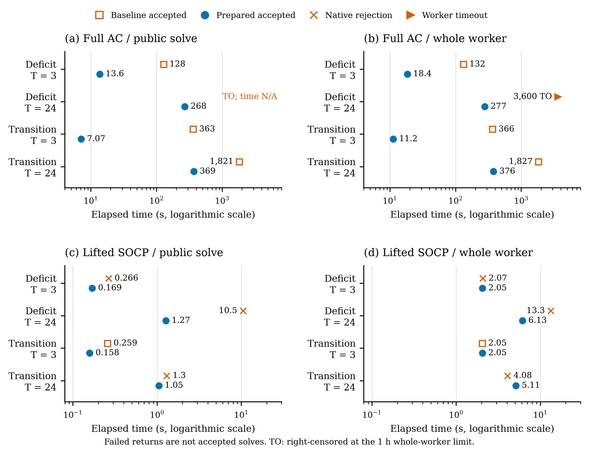
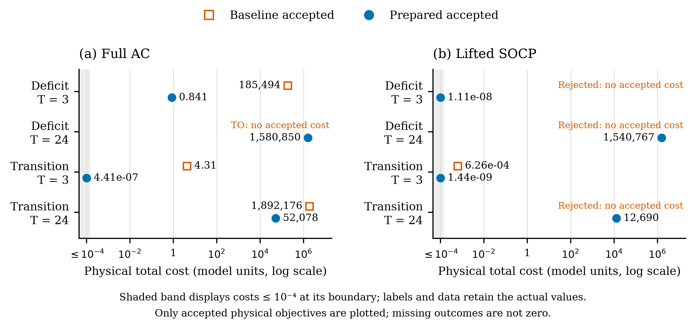

# Serial matched numerical-preparation results

This report records the completed `matched_comparison_001` study for reference
in the CVXOPF IEEE PES paper. A fresh solver-forbidden independent replay
confirmed **12 accepted solutions out of 16 terminal arms**: all eight prepared
arms, compared with four of eight baselines. Three baseline SOCP arms returned
`InsufficientProgress`; the baseline 24-hour large-deficit AC arm reached the
one-hour whole-worker limit. Those four outcomes are retained, not replaced by
zero costs, successful solves, or infeasibility claims.

The main findings differ by formulation:

- **SOCP:** preparation primarily improved numerical acceptance, from 1/4 to
  4/4 cases. In the sole jointly accepted pair, the public solve was 1.64 times
  faster, but whole-worker time was effectively unchanged (2.046 versus 2.046 s).
  Process/setup overhead dominates this small case. Failed native returns are
  not eligible speedup comparisons.
- **Full-physics AC:** preparation produced acceptance in 4/4 cases versus 3/4,
  shortened public solves by 4.93–51.29 times in the three jointly accepted
  pairs, and returned lower reconstructed physical costs. For the 24-hour
  deficit-to-surplus case, physical cost fell from 1,892,175.56 to 52,077.88 model
  cost units, a 97.25% reduction. These are different returned local solutions,
  not evidence of a globally optimal AC solution.

These are bounded, single-run observations, not estimates of a runtime
distribution, universal speedup, or an ablation of individual preparation steps.

## Matched design and accounting

The [comparison plan](MATCHED_COMPARISON_PLAN.md) and
[runner specification](MATCHED_COMPARISON_RUNNER.md) define eight pairs:
two retained Tracy fixtures, two horizons, and two formulations, each with
baseline and prepared treatments. The large-deficit fixture starts at annual
offset 1165; the deficit-to-surplus transition starts at 2439. The half-open
intervals are `[1165,1168)`, `[1165,1189)`, `[2439,2442)`, and `[2439,2463)`.
The source calendar uses fixed UTC−08, not daylight-saving local time.

Each case has 27 batteries, one-hour steps, and its own per-device 50%-to-50%
terminal SOC equality. The three-hour optimization is therefore not a prefix of
the 24-hour optimization. Within each pair, physical inputs, device identities,
constraints, solver settings, and physical cold starts match. Execution used
one serial worker, one numerical thread, fresh processes, and separately
counterbalanced order within AC and SOCP (two pairs of each order per
formulation). There were no warm starts, races, helpers, fallbacks, numerical
retries, or interrupted attempts.

| Representation change | Baseline | Prepared AC | Prepared SOCP |
| --- | --- | --- | --- |
| Device-limit coordinates | Original | Normalized | Normalized |
| Exactly fixed box coordinates | Retained | Removed exactly | Removed exactly |
| Storage/shedding cost coordinates | Original | Cost coordinates | Original |
| Objective assembly | Hourly | Component-first | Hourly |
| Canonical scaling | None | None | Joint5 |

These transformations retain the physical model and acceptance gates. Both AC
treatments use symmetric reconstruction of the canonical objective, original
physical components, and cycling epigraph excess. Native full convergence,
original-unit physical checks, and accounting checks are required for acceptance.
Explained cycling slack is an advisory warning, not an automatic rejection;
unexplained accounting discrepancies remain gated. SOCP acceptance applies to
the lifted model and does **not** establish AC realizability or a certified
global bound.

Stock iteration limits remained IPOPT 3000 and CLARABEL 5000. The enforced limits
were 3600 s per whole worker and 16,384 MiB sampled RSS. The 57,600 cumulative
worker-second threshold was advisory only and was not reached. Total finalized
effort was 6644.59 worker-seconds (1 h 50 min 44.6 s), including the timeout and
all failed returns. Maximum sampled worker RSS was 11,069.53 MiB. Memory values
are sampled peaks, not continuous measurements.

## All terminal outcomes

Times below are seconds. Physical costs are independently reconstructed
standalone-horizon totals in the model's cost units, not native canonical
objectives, dollar claims, or rolling implemented costs. Values are rounded for
reading; [the all-arm CSV](figures/matched_comparison_001/all_arms.csv) retains
full-precision values. A dash means unavailable or no accepted cost, never zero.

| Arm | Fixture | T | Model | Treatment | Outcome | Public solve (s) | Whole worker (s) | Accepted physical cost |
| --- | --- | ---: | --- | --- | --- | ---: | ---: | ---: |
| 1 | Large deficit | 3 | AC | Baseline | Accepted | 128.247 | 131.898 | 185,493.5268 |
| 2 | Large deficit | 3 | AC | Prepared | Accepted | 13.620 | 18.364 | 0.840753 |
| 3 | Large deficit | 3 | SOCP | Baseline | Native rejection | 0.266 | 2.068 | — |
| 4 | Large deficit | 3 | SOCP | Prepared | Accepted | 0.169 | 2.051 | 1.10819e−8 |
| 5 | Large deficit | 24 | AC | Prepared | Accepted | 268.494 | 277.193 | 1,580,849.8854 |
| 6 | Large deficit | 24 | AC | Baseline | Whole-worker timeout | — | 3600.224 | — |
| 7 | Large deficit | 24 | SOCP | Prepared | Accepted | 1.268 | 6.128 | 1,540,766.8472 |
| 8 | Large deficit | 24 | SOCP | Baseline | Native rejection | 10.501 | 13.297 | — |
| 9 | Deficit to surplus | 3 | AC | Baseline | Accepted | 362.717 | 365.967 | 4.311842 |
| 10 | Deficit to surplus | 3 | AC | Prepared | Accepted | 7.072 | 11.215 | 4.41117e−7 |
| 11 | Deficit to surplus | 3 | SOCP | Baseline | Accepted | 0.259 | 2.046 | 6.26223e−4 |
| 12 | Deficit to surplus | 3 | SOCP | Prepared | Accepted | 0.158 | 2.046 | 1.44202e−9 |
| 13 | Deficit to surplus | 24 | AC | Prepared | Accepted | 369.243 | 376.402 | 52,077.8850 |
| 14 | Deficit to surplus | 24 | AC | Baseline | Accepted | 1820.887 | 1826.503 | 1,892,175.5632 |
| 15 | Deficit to surplus | 24 | SOCP | Prepared | Accepted | 1.048 | 5.108 | 12,689.6887 |
| 16 | Deficit to surplus | 24 | SOCP | Baseline | Native rejection | 1.301 | 4.083 | — |

All three native rejections have CLARABEL status `InsufficientProgress` and
retained result/completion evidence. No completed arm was rejected by the
original-unit audit. Arm 6 has finalized supervision but no native return,
result archive, or completion manifest: the controller terminated it at the
whole-worker deadline. Its log's last ordinary iteration was 367, with
`inf_pr = 3.35e2` and `inf_du = 8.86e15`. It did **not** reach an IPOPT
maximum-iteration exit; no completed public-solve duration or physical cost can
be assigned to it. This is a right-censored observation, not an infeasibility
certificate or proof that the problem could never converge.

## Comparable timing



**Figure 1.** Serial matched timings for full-physics AC and lifted SOCP, shown
on logarithmic time axes (different ranges by formulation). Open orange squares
and filled blue circles denote accepted baseline and prepared solutions.
Orange crosses denote observed native rejection times, not accepted solves.
The right-pointing triangle marks the baseline AC whole-worker timeout at one
hour; its completed public-solve time is unavailable. Each row is a separate
energy-neutral horizon. Numeric labels are rounded; exact data are retained.

Vector exports: [PDF](figures/matched_comparison_001/matched_timing.pdf) and
[SVG](figures/matched_comparison_001/matched_timing.svg).

The public-solve clock includes actual canonicalization, preparation, native
solution, and inversion through `OPFBuild.solve`. Whole-worker supervision also
includes imports, admission, model construction, prospective preparation,
independent audit, archival publication, polling, and joined exit. AC adapter
timers are diagnostic only: derivative-oracle construction lies inside the
baseline adapter clock but outside the prepared adapter clock. They are not
used for speedup claims. The complete disjoint timing phases are retained in
the figure-data JSON and raw timing records.

| Jointly accepted pair | Public-solve baseline/prepared | Whole-worker baseline/prepared |
| --- | ---: | ---: |
| Large deficit, AC, T=3 | 9.416 | 7.182 |
| Deficit to surplus, AC, T=3 | 51.290 | 32.632 |
| Deficit to surplus, SOCP, T=3 | 1.636 | 1.0002 |
| Deficit to surplus, AC, T=24 | 4.931 | 4.853 |

Ratios use only pairs accepted on both sides. In particular, the timed-out AC
case and three rejected SOCP cases have no accepted-pair speedup. The prepared
24-hour large-deficit AC solution took 268.49 s public solve and 277.19 s whole
worker, but dividing the timeout by that duration would not give a measured
accepted-pair speedup. Likewise, prepared SOCP arm 15 used more whole-worker
time than rejected baseline arm 16 (5.108 versus 4.083 s); completing and
auditing a solution is not the same outcome as returning a failure quickly.

## Physical economics and numerical accuracy



**Figure 2.** Reconstructed physical total costs for accepted full-physics AC
and lifted SOCP solutions. Costs include generator, storage cycling, and load
shedding components in original physical coordinates. Missing accepted costs
are annotated as rejection or timeout, not plotted at zero. Logarithmic axes
use a display-only near-zero band: costs at or below 1e−4 are drawn at that
boundary while annotations and downloadable data retain their actual values.
The threshold changes neither acceptance nor reported economics. SOCP costs
refer to lifted-model solutions, not independently established AC-feasible
dispatches.

Vector exports: [PDF](figures/matched_comparison_001/matched_physical_cost.pdf)
and [SVG](figures/matched_comparison_001/matched_physical_cost.svg).

The strongest economically material matched observation is the 24-hour AC
transition: preparation reduced returned physical cost by 1,840,097.68 model
units (97.25%). Generator cost changed from 1,892,090.85 to 51,805.47 model
units; storage and shedding comprise the remainder (see exact components in
the snapshot). The three-hour costs also decreased, but relative percentages
near zero are a poor description of practical economic significance.

All three accepted baseline AC solutions carried explained cycling-slack
warnings; no prepared AC solution did. For baseline transition T=3, native
canonical cost exceeds physical cost by 10,683.56 model units; the analogous
T=24 excess is 143.45. These warnings do not invalidate their accepted physical
solutions, nor should canonical totals be used as implemented economics. The
cost improvement remains after reconstructing physical components and removing
that explained epigraph excess: it is not merely an auxiliary-slack accounting
artifact. The bundled treatment can change the nonlinear solver's numerical
path and the local solution returned, even though the intended physical problem
is unchanged. This study does not isolate which preparation step caused the
change.

Prepared AC solutions passed the same physical checks as the baselines. Across
the four prepared AC cases, maximum active/reactive balance residuals were
5.706e−9 / 9.985e−8 per unit (gates 1e−6), maximum SOC-recurrence residual was
3.908e−13 MWh (gate 1e−4 MWh), and maximum energy not served was 2.983e−8 MWh.
Prepared SOCP maximum active/reactive nodal-balance residuals were
6.075e−10 MW / 2.499e−9 MVAr. Full original-unit residuals and their gates are
retained per arm in the snapshot; native IPOPT scaled and unscaled residuals
are stored separately and must not be substituted for engineering checks.
In particular, an IPOPT successful exit is a solver-tolerance statement, not a
claim of identical unscaled stationarity across representations.

For the difficult large-deficit 24-hour AC segment, the prepared solve exited
with `EXIT: Optimal Solution Found.` after 119 iterations. Its final native
constraint violation was 1.830e−8, scaled dual infeasibility 1.821e−8
(unscaled 2.268e−6), and scaled complementarity 1.304e−10
(unscaled 1.625e−8). It returned physical cost 1,580,849.89 with negligible
shedding (1.489e−9 MWh). Preparation thus made this particular cold-start case
usable within the budget; the baseline timeout tells us about numerical
behavior under this protocol, not physical impossibility.

## Provenance, preservation, and reproduction

The study completed at 2026-10-13 20:14:42.719673 UTC, after first worker launch
at 18:23:33.010148 UTC. Figure extraction performed another full independent
replay with native optimization forbidden. Counts were 16 finalized supervision
records, 15 result archives, 15 completion manifests, 15 native returns, and
eight AC start records. The one absent returned bundle belongs to the timeout;
it is not an unexplained artifact mismatch. There are no active partials.

- Execution commit: `49bdebf09179f0b75602fb98a9d52fbcb7654b68`.
- Frozen binding SHA256:
  `92d8d6a24774b2f9be7918df7db7beb72f1695335b346f7d06826c51cc9fb79f`.
- Matching authority SHA256:
  `085e5b6a2a1fa433e5572e34ee05ef2d5a932835db89f5637382a33d60a112d7`.
- Recorded runtime: macOS 26.7.1 ARM64; CVXPY 1.9.3, IPOPT 3.14.19,
  cyipopt 1.7.0, CLARABEL 0.11.1, sparsediffpy 0.6.1, NumPy 2.4.6,
  SciPy 1.17.1, pandas 3.0.3. Numerical thread environment is frozen to one.
  Exact runtime and source fingerprints remain in the raw binding;
  this report does not claim cross-machine absolute timing portability.

Raw evidence remains untouched in `results/matched_comparison_001/` (ignored
research data). The publication bundle is outside that execution tree and
contains two vector PDFs, two editable SVGs, 400-dpi PNG previews,
[all-arm CSV](figures/matched_comparison_001/all_arms.csv),
[audited snapshot](figures/matched_comparison_001/figure_data.json), and a
[hash manifest](figures/matched_comparison_001/manifest.json). The snapshot
records exact timings, costs, components, policies, residuals, limits, native
exit summaries, acceptance, extraction timestamp, source hashes, and all 175
raw-file SHA256 values. Before/after hashing verifies extraction and plotting
did not alter the execution tree. Historical qualification, E3, three-step, E4,
and rolling results are neither rewritten nor pooled into this comparison.

From the repo root, rerun a solver-forbidden extraction into a **fresh** analysis
directory; existing output is never overwritten:

```sh
MPLCONFIGDIR=/private/tmp/cvxopf-matched-mpl \
XDG_CACHE_HOME=/private/tmp/cvxopf-figure-cache \
UV_CACHE_DIR=/private/tmp/cvxopf-uv-cache \
uv run --offline --no-sync --extra notebook \
  python -m experiments.numerical_preparation.plot_matched_comparison \
  --output experiments/numerical_preparation/results/matched_publication_NEW
```

The `--snapshot experiments/numerical_preparation/figures/matched_comparison_001/figure_data.json`
option rerenders an existing audited snapshot into a fresh output
directory and verifies raw-tree identity. It does not perform a new scientific
replay; the original extraction timestamp remains visible. If relevant bound
dependencies change, do not silently relabel a cached replay as fresh.

Publication validation: 140 non-solving tests passed across the matched runner,
publication renderer, qualification, and three-step analysis suites;
repository-wide Ruff passed. Both final one-page PDFs were rasterized and
visually inspected, and their fonts are embedded. Final checks verified all
raw-file and publication-file hashes and every local report link. No OPF solve
was launched during extraction, figure generation, or validation.

## Suggested paper wording

> In a serial, cold-start matched study of two Tracy operating segments at
> 3- and 24-hour horizons, numerical preparation yielded eight accepted solutions
> out of eight cases, compared with four of eight for the baseline representation.
> Prepared SOCP accepted all four cases; three baseline SOCP runs terminated with
> insufficient progress. Prepared AC accepted all four cases; one baseline AC
> run reached the one-hour whole-worker limit. Across the three jointly accepted
> AC pairs, public-solve times were reduced by factors of 4.93–51.29. In the
> 24-hour transition case, independently reconstructed physical cost decreased
> by 97.25%. These single-run observations concern numerical behavior and returned
> local AC solutions under unchanged physical constraints and acceptance gates;
> they are not global-optimality or universal-runtime claims.
